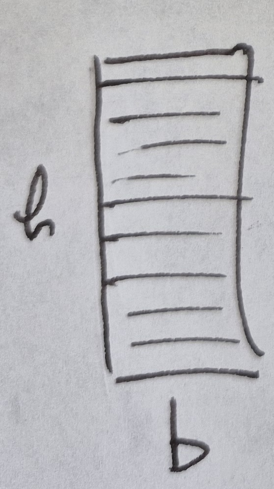
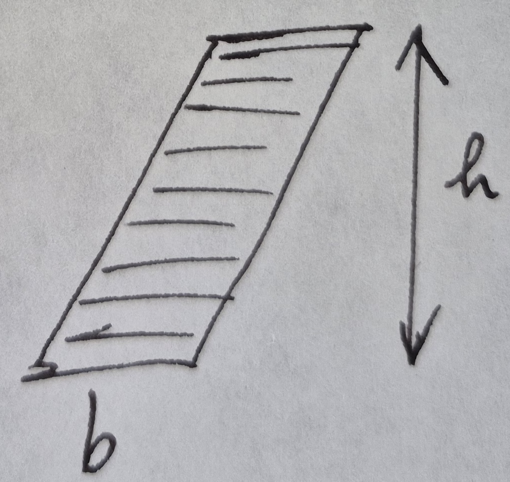
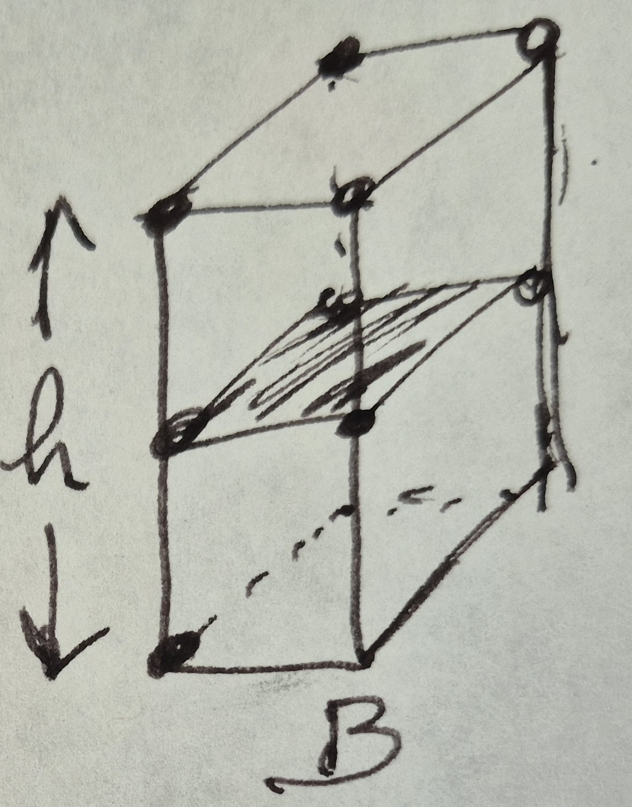
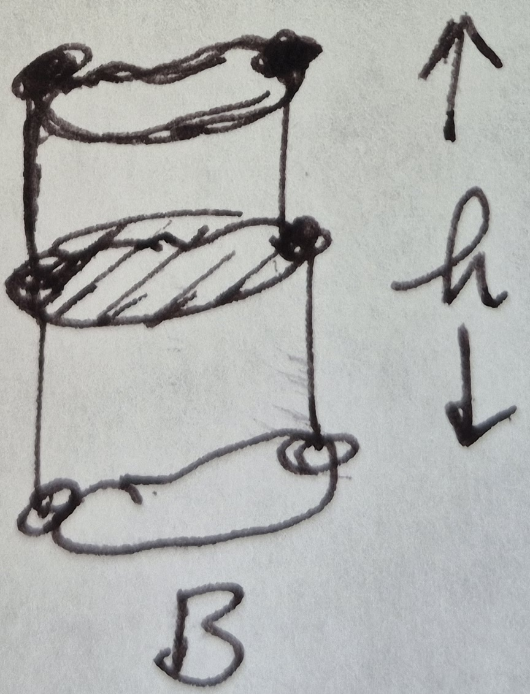
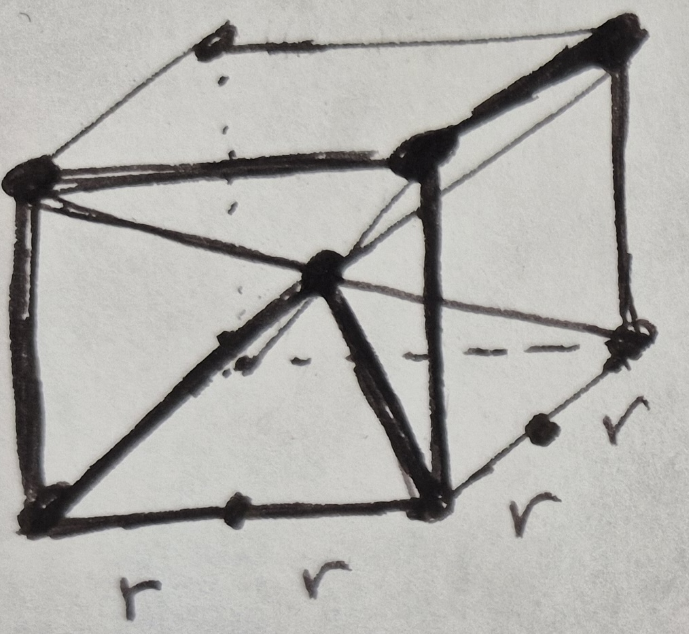
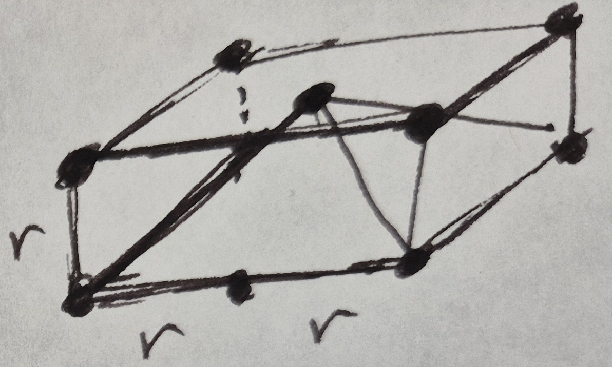
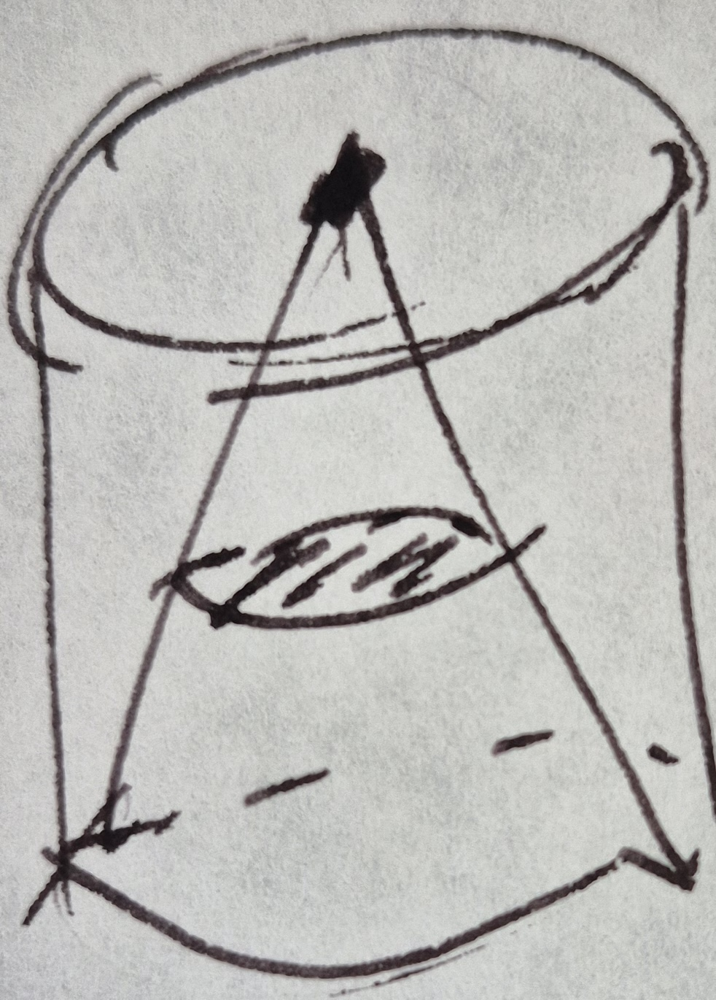
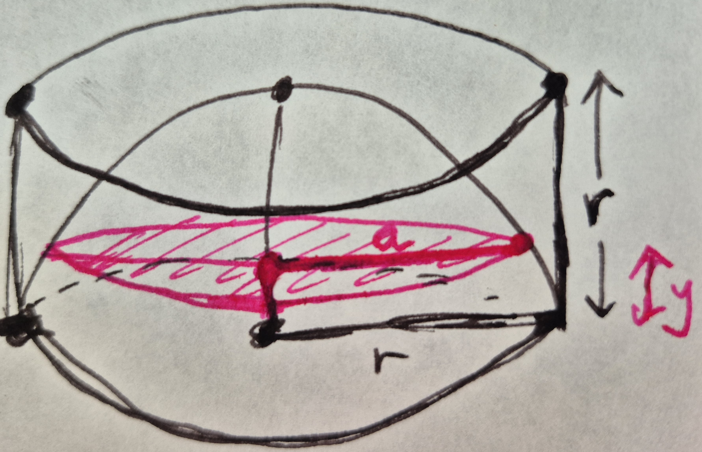
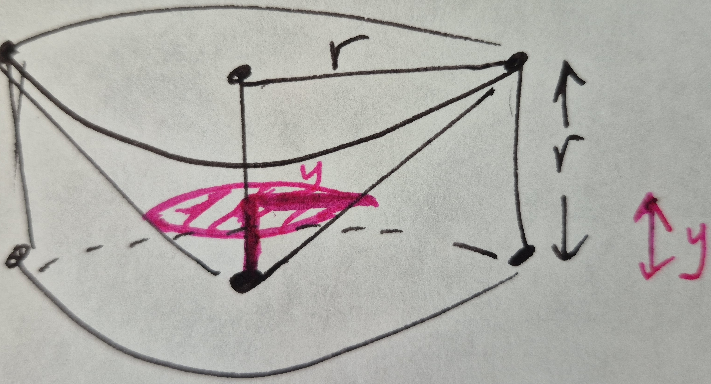

class: title

 

## Ellison    
## Medical   
## Institute    

   
   
   

# On the Sphere and Cylinder

### Darren Kessner | Joy of Science 2026

---

layout:true

class: normal

.footer[
Ellison Medical Institute 
]

---

class: normal

#  On the Sphere and Cylinder

Archimedes  
c. 225 BCE  

---

class: normal

#  Area

 

$$
A = b \cdot h
$$

 

---

class: normal

# Volume

 

$$
A = B \cdot h
$$

 

__Cavalieri's Principle__: &nbsp; same area slices -> same volume

---

class: normal

# Pyramids 

$$
V = \text{volume of pyramid}
$$

$$
V_{\text{cube}} = 6 \cdot V
$$

$$
V_{\text{prism}} = 3 \cdot V
$$

$$
V = \dfrac{1}{3} \cdot V_{\text{prism}}
$$

---

class: normal

# Cones

$$
V = \dfrac{1}{3} \cdot V_{\text{cylinder}}
$$

$$
    = \dfrac{1}{3} (\pi r^2) h
$$

---

class: normal

# Sphere Volume

$$
A_{\text{slice}} = \pi a^2  = \pi (r^2 - y^2)
$$

 

$$
A_{\text{cone slice}} = \pi y^2 
$$

$$
A_{\text{ring}} = \pi r^2 - \pi y^2
$$

 

$$
V = \dfrac{2}{3} V_{cylinder} = \dfrac{2}{3} (\pi r^2) (2r)
$$

$$
V = \dfrac{4}{3}\pi r^3
$$

---

class: normal

# Sphere Surface Area

 

Calculus:

$$
\dfrac{d}{dr}(\dfrac{4}{3} \pi r^3) = 4 \pi r^2
$$

 

Hat-box theorem / Lambert projection:

$$
SA_{cylinder} = (2 \pi r)(2r) = 4 \pi r^2
$$

